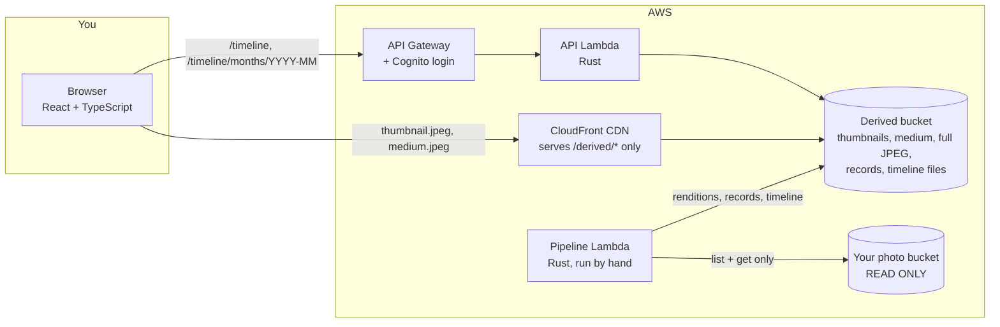

<div align="center">


### Your whole RAW library, by date, on every screen.

A self-hosted photo timeline for people who shoot RAW.
Point it at an S3 bucket of camera files and get a fast, Google-Photos-style web app.
Your originals are never touched.


</div>

---

## Why this exists

General photo clouds treat RAW files as an afterthought. They support few Fujifilm RAF files, or show
only the embedded JPEG, or store RAW without a preview. Catalog-based tools work, but they put your
library inside their own database.

lawt does one thing: it turns a folder tree of camera files (`100RICOH/R0001234.DNG`,
`100_FUJI/DSCF0025.RAF`, ...) into a timeline you can scroll by capture date, and it keeps the
originals exactly as they are.

## What you get

- **A timeline by capture date.** All folders merged, day headers, a date scrubber, and a viewer with
  keyboard navigation and next/previous preloading. Works on phone and desktop.
- **Every camera format.** RAW (RAF, NEF, CR2, CR3, ARW, DNG, ORF and more), TIFF including 16-bit,
  JPEG, PNG, WebP, GIF and BMP. See [Supported formats](#supported-formats).
- **Fast.** The browser loads a small day index first, then one file per month, then cached thumbnails
  from a CDN. No bucket listing on page load.
- **Safe for your originals.** The indexing code can only read the photo bucket. It has no function that
  writes, copies or deletes there, and its IAM role does not allow it either.
- **Camera data captured once.** Make, model, lens, ISO, aperture, shutter speed, focal length and GPS
  are stored while each photo is processed, so search can be added without reading the originals again.
- **Small footprint.** For a 278 GB library of 7,826 photos, the generated files are 15 GB. See
  [Resource use](#resource-use).

> **Status:** early, built for one owner and one library. It is not multi-user yet. Expect rough edges
> and read [Limitations](#limitations) before relying on it.

## How it works



The pipeline runs in three steps, each safe to repeat:

1. **plan** lists the photo bucket and finds photos that have no record yet. It downloads nothing.
2. **run** downloads each new original once, extracts the camera's embedded preview (RAW) or decodes
   the image, fixes orientation, writes three JPEG sizes and a small JSON record to the derived bucket.
3. **publish** rebuilds the timeline files from all records.

Photos with the same folder and file name (`R0001.RAF` and `R0001.JPG`) become one photo. A RAW is
preferred over a TIFF, and a TIFF over a JPEG.

## Try it locally in two minutes (no AWS)

The dev server serves about 2,500 synthetic photos so you can see the UI without any cloud account.

You need [Rust](https://rustup.rs) and [Node.js](https://nodejs.org) 20 or newer.

```bash
cd backend
cargo run -p lawt-dev-server
```

In a second terminal:

```bash
cd frontend
npm ci
VITE_API_BASE_URL=http://localhost:3002/api npm run dev
```

Open http://localhost:5173 and choose **Continue as Guest**.

## Run it on your own AWS account

You will deploy one CDK stack. It imports your existing photo bucket and Cognito pool and creates
everything else. Plan for about an hour the first time.

### Prerequisites

| Need | Notes |
|---|---|
| AWS account and CLI credentials | Region of your choice. Pin it in `lawt.env`. |
| An S3 bucket with your photos | Keys must look like `all images/<folder>/<file>`. lawt only reads it. |
| A Cognito user pool | With a hosted UI domain, one user (you), and an app client that has a **client secret**, the **authorization code grant** and scopes `openid email profile`. |
| Node.js 20+ | |
| Rust (stable) and [cargo-lambda](https://www.cargo-lambda.info) | To build the Lambdas for arm64. |
| [Zig](https://ziglang.org) | Used only as the cross-compile linker. `brew install zig` or `pip install ziglang`. |

### 1. Configure

```bash
cp lawt.env.example lawt.env
cp frontend/.env.production.example frontend/.env.production
```

Edit `lawt.env` (account, region, photo bucket, Cognito ids and domain). Every setting is
described in the file. Both files are git-ignored.

### 2. Bootstrap CDK once

```bash
cd infra/cdk
npm ci
npx cdk bootstrap aws://<account-id>/<region>
cd ../..
```

### 3. First deploy

```bash
make deploy CDK_FLAGS='-c enablePipeline=true'
```

This builds the Lambdas and the frontend, shows a synth, and deploys. `enablePipeline=true` adds the
indexing function. **Pass this flag on every later deploy too**: deploying without it removes the function.

### 4. Wire up the frontend and Cognito

Read the stack outputs:

```bash
aws cloudformation describe-stacks --stack-name LawtStack --region <region> \
  --query "Stacks[0].Outputs[].[OutputKey,OutputValue]" --output table
```

- Put `APIEndpoint` (without the trailing slash) into `VITE_API_BASE_URL` and `RenditionCdnURL` into
  `VITE_RENDITION_BASE_URL` in `frontend/.env.production`. Set `VITE_COGNITO_LOGIN_REDIRECT` and
  `VITE_COGNITO_LOGOUT_REDIRECT` to `FrontendURL` plus a trailing slash.
- In the Cognito console, add that same `FrontendURL/` as an **allowed callback URL** and **sign-out URL**
  on the app client.
- Deploy again so the new values are baked into the bundle:

```bash
make deploy CDK_FLAGS='-c enablePipeline=true'
```

### 5. Index your photos

The pipeline never runs by itself. You start it, and you can start small. Replace `<region>`.

Count what is there (lists keys only, downloads nothing):

```bash
aws lambda invoke --function-name lawt-pipeline --region <region> \
  --cli-binary-format raw-in-base64-out --cli-read-timeout 900 \
  --payload '{"action":"plan"}' /dev/stdout
```

Render five photos from one folder and look at the result:

```bash
aws lambda invoke --function-name lawt-pipeline --region <region> \
  --cli-binary-format raw-in-base64-out --cli-read-timeout 900 \
  --payload '{"action":"run","folder":"100RICOH","limit":5}' /dev/stdout
```

Then run without `folder` and with a larger `limit` (the default is 25) until the answer shows
`"remaining_after_batch": 0`. Each run republishes the timeline. Open `FrontendURL` and log in.

Rough speed: about 8,000 photos took 22 minutes with six parallel workers.

## Troubleshooting

| Symptom | Cause | Fix |
|---|---|---|
| `cdk synth` says `Missing settings` | `lawt.env` is missing or incomplete | Copy `lawt.env.example` and fill every line |
| `cdk synth` cannot find `target/lambda/...` | The Lambdas are not built | `make build-rust` (needs `cargo-lambda` and `zig`) |
| `cargo lambda build` says Zig is not installed | The cross-compile linker is missing | `brew install zig` or `pip install ziglang` |
| Every API call returns 401 | No login token, or the Cognito app client is not set up for the code grant | Check callback URL, grant type and scopes. Log out and back in. |
| After login you land on the Cognito error page | `FrontendURL/` is not an allowed callback URL | Add it, with the trailing slash, on the app client |
| The browser shows CORS errors on a 401 | Stale frontend bundle pointing at an old API | Rebuild the frontend after any `.env.production` change and redeploy |
| The timeline says "Your timeline is empty" | The pipeline has not run yet | Run `plan`, then `run`, see step 5 |
| `lawt-pipeline` function disappeared | A deploy without `-c enablePipeline=true` | Deploy again with the flag |
| Thumbnails are grey tiles with `RAF` text | The photo has no readable embedded preview, or its status is `failed` | Open the record in `records/<id>.json` in the derived bucket and read `reason` |
| A dev build talks to production | A leftover `frontend/.env.local` | Delete it. `make build-frontend` creates it. |

## Updating

```bash
git pull
make deploy CDK_FLAGS='-c enablePipeline=true'
```

New photos in the bucket are picked up by running the pipeline again. It skips photos that already
have a record. Add `"force": true` to the payload to re-render them, for example after a processor fix.

## Configuration

**`lawt.env`** (deployment, read by CDK and the Makefile)

| Name | Meaning |
|---|---|
| `AWS_ACCOUNT` | AWS account id |
| `AWS_REGION` | Region for every resource |
| `PHOTO_BUCKET` | Existing bucket with your originals (read only) |
| `COGNITO_USER_POOL_ID` | Existing user pool |
| `COGNITO_USER_POOL_CLIENT_ID` | App client of that pool |
| `COGNITO_DOMAIN` | Hosted UI host of that pool |
| `APP_NAME` (optional) | Prefix of function names. Default `lawt`. |
| `STACK_NAME` (optional) | CloudFormation stack name. Default `LawtStack`. |

**`frontend/.env.production`** (baked into the bundle at build time): see
[`frontend/.env.production.example`](frontend/.env.production.example).

## Supported formats

| Kind | Extensions | How it is read |
|---|---|---|
| Camera RAW | RAF, NEF, CR2, CR3, ARW, DNG, ORF, SR2, 3FR, FFF, MOS, IA, PEF, RW2, RWL, RWZ, X3F, SRW, K25, KDC | The largest preview JPEG the camera embedded (via [rawler](https://crates.io/crates/rawler)). No demosaicing. |
| TIFF | TIF, TIFF (8 and 16-bit) | Decoded and converted to 8-bit |
| Other images | JPG, PNG, WebP, GIF, BMP | Decoded |
| HEIC, HEIF | | Listed in the timeline with a placeholder tile, not rendered yet |

Tested on real files: Fujifilm RAF, Ricoh GR DNG and JPEG. Other brands depend on `rawler` and are
untested here. If a RAW has no embedded preview it is listed with a placeholder tile.

## Resource use

Measured on the author's library:

| | |
|---|---|
| Photos | 7,826 (RAF 6,181, DNG 1,110, JPG 506, TIFF 28) |
| Originals | 277.8 GB, average 35.5 MB per photo |
| Generated files | 15.1 GB, 5.4 % of the originals |
| First full run | about 22 minutes with six parallel workers |

You pay AWS for the generated files, requests, CDN traffic and one secret, on top of wherever your
originals are stored. Use the [AWS calculator](https://calculator.aws/) with these numbers for your own estimate.

## Project layout

| Path | What |
|---|---|
| `backend/crates/common` | Pure domain logic: formats, key validation, photo ids, timeline model |
| `backend/crates/processor` | Decoding, orientation, resizing, JPEG encoding |
| `backend/crates/pipeline`, `pipeline-lambda` | plan, run, publish |
| `backend/crates/api`, `api-lambda` | Timeline API |
| `backend/crates/dev-server` | Local server with a synthetic library |
| `frontend/src/timeline` | The timeline UI |
| `infra/cdk` | The CDK stack |
| `docs/` | Architecture, runbook, decision record |

TypeScript types for the API are generated from the Rust structs (`cargo test --all-features` in
`backend/` rewrites `frontend/src/api/generated/`).

## Develop

```bash
cd backend  && cargo fmt --check && cargo clippy --workspace --all-targets --all-features -- -D warnings && cargo test --workspace --all-features
cd frontend && npm run typecheck && npm test && npm run build
cd infra/cdk && npx cdk synth
```

## Limitations

- Single owner. There is no multi-user support or upload flow. Photos get into the bucket
  with tools you already use, such as `rclone`.
- Thumbnails are served from unguessable, salted URLs. Anyone who has a URL can view that one image.
  Signed cookies would make them strictly private and are on the roadmap.
- 16-bit TIFF colour profiles are not applied yet, so wide-gamut exports may look flat.
- HEIC is not rendered.
- The old gallery and a few Node 20 Lambdas are still in the repo while the Rust port finishes.
- New photos appear only after you run the pipeline again.

## Roadmap

Expiring share links, a bin with 30-day restore, search by camera and lens, multi-select, and a
desktop uploader. See [TODO.md](TODO.md) and the open issues.

## License

[MIT](LICENSE)
