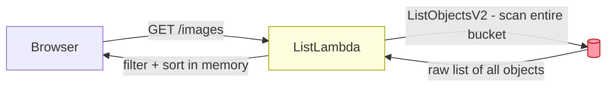
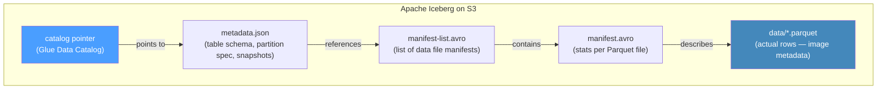
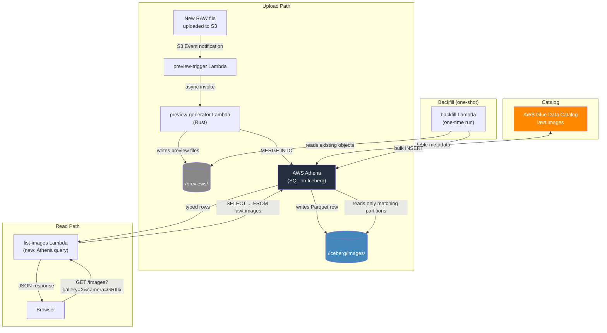
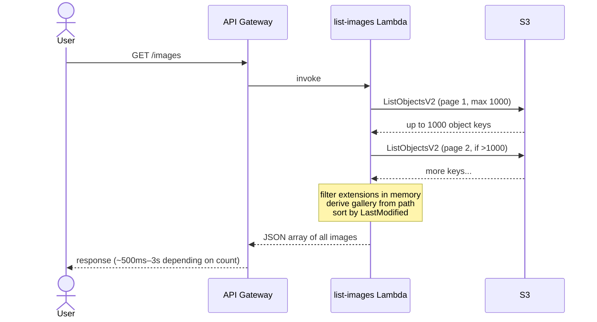
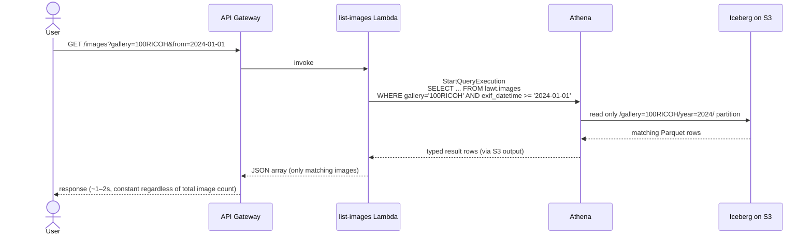
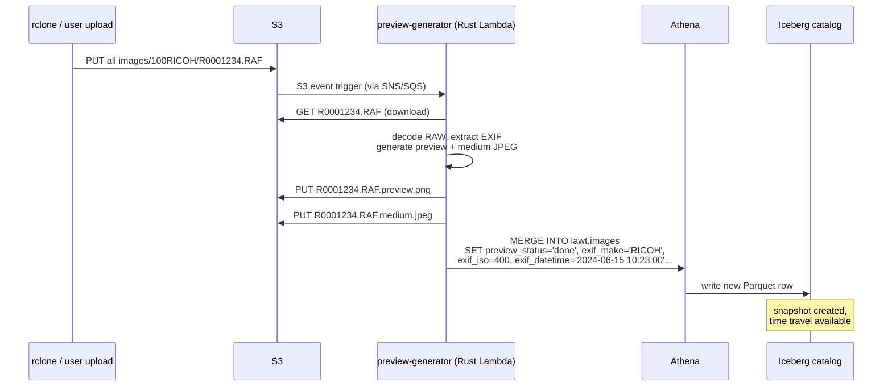
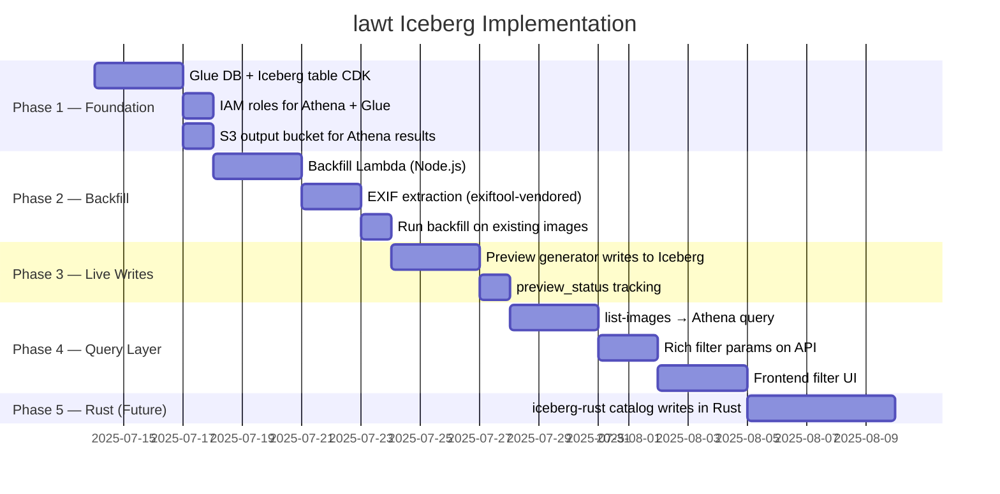
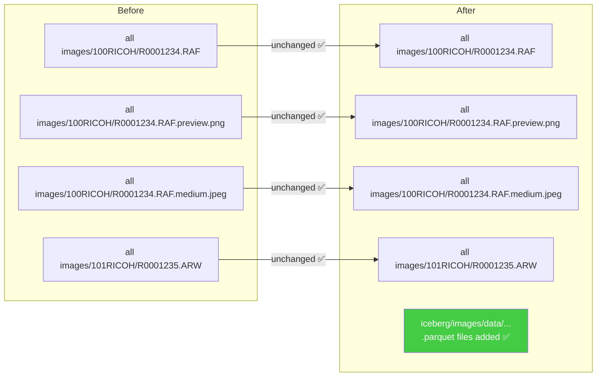
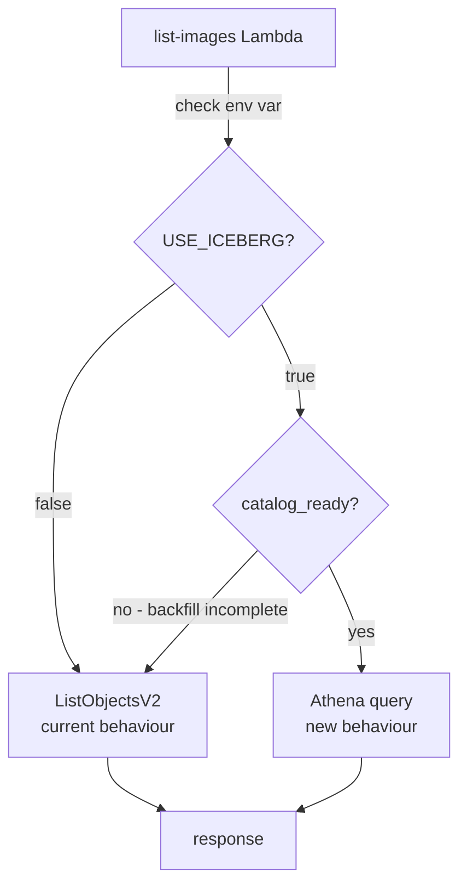

# Apache Iceberg for lawt — Architecture Plan

> **Status**: Draft for review — **superseded in part by [ADR 0001](adr/0001-iceberg-catalog.md)** (cost math, read path, write path and sync gaps corrected there)  
> **Date**: 2025-07  
> **Scope**: Replace `ListObjectsV2` catalog with a proper Apache Iceberg table on S3 + Glue, enabling rich EXIF queries, partitioned reads, and a metadata-first architecture.

---

## Table of Contents

1. [The Problem Today](#1-the-problem-today)
2. [What Apache Iceberg Is](#2-what-apache-iceberg-is)
3. [Target Architecture](#3-target-architecture)
4. [Data Flow — How It Works Today vs After](#4-data-flow)
5. [Iceberg Table Schema](#5-iceberg-table-schema)
6. [Implementation Phases](#6-implementation-phases)
7. [Pros & Cons](#7-pros--cons)
8. [Cost Analysis](#8-cost-analysis)
9. [Data Safety — Will We Lose Anything?](#9-data-safety--will-we-lose-anything)
10. [Decision Checklist](#10-decision-checklist)

---

## 1. The Problem Today

The current `list-images` Lambda runs a **full `ListObjectsV2` scan** on the entire S3 bucket on every page load. This works now but has hard limits:

| Pain Point | Root Cause | Impact at Scale |
|---|---|---|
| Full bucket scan per request | `ListObjectsV2` has no filter | ~1s per 1K objects, linear cost growth |
| No EXIF metadata | S3 objects carry no schema | Can't filter by camera, date, ISO, etc. |
| Gallery = folder name only | Derived from S3 key prefix | No tags, albums, or cross-folder views |
| Preview state is unknown | No catalog | Can't efficiently know which RAWs need previews |
| No history / audit | No versioning | Can't answer "what was added this week?" |
| Sorting is in-memory | All 1000+ objects loaded first | Memory pressure in Lambda, slow cold starts |



**The core problem**: S3 is being used as both a file store and a database. It is excellent at the former and terrible at the latter.

---

## 2. What Apache Iceberg Is

Apache Iceberg is an **open table format** — it sits on top of S3 and adds a catalog layer (metadata files) that makes your S3 data queryable like a relational table, without any servers.



Key properties relevant to lawt:

- **Schema enforcement** — every image row has typed columns (ISO is an INT, not a string)
- **Partition pruning** — a query for `gallery='100RICOH'` reads only that partition's Parquet files, not the whole bucket
- **ACID transactions** — two Lambdas writing at the same time won't corrupt the catalog
- **Time travel** — every write creates a snapshot; you can query the catalog as it was last week
- **Zero new servers** — catalog lives in Glue (free tier covers us), queries run on Athena (serverless, pay-per-query)

---

## 3. Target Architecture



**Important**: The RAW files in S3 are **never touched**. Iceberg only adds a new `/iceberg/` prefix containing small Parquet metadata files. The bucket layout becomes:

```
s3://<photo-bucket>/
├── all images/                    ← unchanged — your RAW files live here
│   ├── 100RICOH/
│   │   ├── R0001234.RAF           ← unchanged
│   │   ├── R0001234.RAF.preview.png  ← unchanged
│   │   └── R0001234.RAF.medium.jpeg  ← unchanged
│   └── 101RICOH/
│       └── ...
└── iceberg/                       ← NEW — only metadata/Parquet, no raw files
    └── images/
        ├── metadata/
        │   ├── v1.metadata.json
        │   └── snap-*.avro
        └── data/
            ├── gallery=100RICOH/year=2024/
            │   └── 00001-abc.parquet  ← ~5KB per 1000 images
            └── gallery=101RICOH/year=2025/
                └── 00001-def.parquet
```

---

## 4. Data Flow

### Today



### After Iceberg



### New Image Upload Flow (After)



---

## 5. Iceberg Table Schema

```sql
CREATE TABLE lawt.images (

  -- Identity
  id                STRING     COMMENT 'S3 key — primary identity',
  s3_key            STRING     COMMENT 'Full S3 object key',
  gallery           STRING     COMMENT 'Folder/album name (from path prefix)',
  name              STRING     COMMENT 'Filename without extension',
  extension         STRING     COMMENT 'Lowercase extension: raf, jpg, arw, ...',
  is_raw            BOOLEAN    COMMENT 'True for RAW camera formats',

  -- File metadata
  size_bytes        BIGINT     COMMENT 'S3 object size in bytes',
  uploaded_at       TIMESTAMP  COMMENT 'S3 LastModified timestamp',

  -- Preview state
  preview_path      STRING     COMMENT 'S3 key for .preview.png',
  medium_path       STRING     COMMENT 'S3 key for .medium.jpeg',
  thumbnail_path    STRING     COMMENT 'S3 key for .thumbnail.jpeg (future)',
  preview_status    STRING     COMMENT 'pending | done | failed',

  -- EXIF — camera
  exif_make         STRING     COMMENT 'Camera manufacturer (RICOH, Sony, Nikon...)',
  exif_model        STRING     COMMENT 'Camera model (GR IIIx, A7IV...)',
  exif_lens         STRING     COMMENT 'Lens model if available',

  -- EXIF — exposure
  exif_datetime     TIMESTAMP  COMMENT 'Shot timestamp from EXIF DateTimeOriginal',
  exif_iso          INT        COMMENT 'ISO sensitivity value',
  exif_aperture     DOUBLE     COMMENT 'f-number (e.g. 2.8)',
  exif_shutter      STRING     COMMENT 'Shutter speed string (e.g. 1/250)',
  exif_focal_length DOUBLE     COMMENT 'Focal length in mm',
  exif_focal_35mm   INT        COMMENT '35mm equivalent focal length',

  -- EXIF — location (optional)
  exif_gps_lat      DOUBLE     COMMENT 'GPS latitude (null if not present)',
  exif_gps_lon      DOUBLE     COMMENT 'GPS longitude (null if not present)'

)
PARTITIONED BY (gallery, year(exif_datetime))
TBLPROPERTIES (
  'table_type' = 'ICEBERG',
  'format'     = 'parquet',
  'write_compression' = 'zstd'
);
```

**Why these partitions?**

| Query Pattern | Partition Used | Files Read |
|---|---|---|
| `WHERE gallery='100RICOH'` | `gallery` | 1 partition |
| `WHERE exif_datetime BETWEEN '2024-01-01' AND '2024-12-31'` | `year(exif_datetime)` | 1 year partition |
| `WHERE gallery='100RICOH' AND year=2024` | both | 1 file |
| `WHERE exif_make='RICOH'` | none | all files (but Parquet column stats skip non-matching row groups) |
| `SELECT DISTINCT gallery` | metadata only | 0 data files read |

---

## 6. Implementation Phases



### Phase 1 — Foundation (CDK changes)

**Files to change**: `infra/cdk/lib/lawt-stack.js`

```js
// New: Glue Database
const glueDb = new glue.CfnDatabase(this, 'lawtGlueDb', {
  catalogId: this.account,
  databaseInput: { name: 'lawt' }
});

// New: Athena results bucket (required by Athena)
const athenaResultsBucket = new s3.Bucket(this, 'AthenaResultsBucket', {
  bucketName: `lawt-athena-results-${this.account}`,
  lifecycleRules: [{ expiration: Duration.days(1) }], // auto-clean query results
  blockPublicAccess: s3.BlockPublicAccess.BLOCK_ALL,
  removalPolicy: cdk.RemovalPolicy.DESTROY,
  autoDeleteObjects: true,
});

// New: Athena WorkGroup
const athenaWorkgroup = new athena.CfnWorkGroup(this, 'lawtWorkGroup', {
  name: 'lawt',
  workGroupConfiguration: {
    resultConfiguration: {
      outputLocation: `s3://${athenaResultsBucket.bucketName}/results/`
    }
  }
});
```

### Phase 2 — Backfill Lambda

One-shot Lambda that:
1. Runs `ListObjectsV2` (the last time we ever use it)
2. For each image file: reads EXIF via `exiftool-vendored` (Node.js) or `kamadak-exif` (Rust)
3. Batches rows into INSERT statements to Athena
4. Sets `preview_status` based on whether `.preview.png` exists

**Can be triggered manually** via AWS Console or CLI — not part of the live API path.

### Phase 3 — Preview Generator writes to Iceberg

Modify `preview-generator-rust/src/main.rs` to add after preview generation:

```rust
// After writing preview files to S3:
let sql = format!(
    "INSERT INTO lawt.images VALUES ('{}', '{}', '{}', '{}', {}, {}, {}, {}, TIMESTAMP '{}', {})",
    s3_key, gallery, name, extension, size_bytes, is_raw,
    preview_path, "done",
    exif_datetime.format("%Y-%m-%d %H:%M:%S"),
    exif_iso.unwrap_or(0)
);
athena_client.start_query_execution(sql, "lawt").await?;
```

### Phase 4 — Replace `list-images` Lambda

New query logic (replacing the `ListObjectsV2` loop entirely):

```js
const sql = `
  SELECT
    id, s3_key, gallery, name, extension, is_raw, size_bytes,
    uploaded_at, preview_path, medium_path, preview_status,
    exif_make, exif_model, exif_datetime, exif_iso,
    exif_aperture, exif_shutter, exif_focal_length
  FROM lawt.images
  WHERE preview_status = 'done'
  ${gallery ? `AND gallery = '${escapeSql(gallery)}'` : ''}
  ${camera  ? `AND exif_model ILIKE '%${escapeSql(camera)}%'` : ''}
  ${from    ? `AND exif_datetime >= TIMESTAMP '${from}'` : ''}
  ${to      ? `AND exif_datetime <= TIMESTAMP '${to}'` : ''}
  ORDER BY exif_datetime DESC
  LIMIT 500
`;
```

---

## 7. Pros & Cons

### ✅ Pros

| Benefit | Detail |
|---|---|
| **Rich EXIF filtering** | Filter by camera model, ISO range, date, focal length — impossible today |
| **Constant query time** | Athena reads only matching partitions regardless of total image count. 10 images or 100,000 images — same latency |
| **No more full bucket scans** | `ListObjectsV2` will never be called on page load again |
| **Schema evolution** | Add new EXIF columns later (GPS, colour profile, rating) without migration — Iceberg handles schema changes gracefully |
| **Time travel** | Query the catalog as it was at any past timestamp. "Show me what was in the gallery on 1st Jan" |
| **Snapshots for free** | Every write is an atomic snapshot — no partial reads possible |
| **Cheaper at scale** | At 10,000+ images, Athena + Iceberg is dramatically cheaper than S3 ListObjects per-request |
| **Open format** | Parquet + Iceberg can be read by Spark, DuckDB, Polars, Trino — you're not locked into AWS |
| **"Missing previews" view** | `WHERE preview_status = 'pending'` — instant visibility into what needs processing |
| **Foundation for ML** | Parquet catalog with EXIF data is immediately ready for photo clustering, duplicate detection, etc. |

### ❌ Cons

| Downside | Severity | Mitigation |
|---|---|---|
| **Athena query latency** | Medium — Athena is 1–3s per query, not <100ms | Cache results in Lambda or add DynamoDB fast-path for top galleries |
| **Athena cold start** | Low — first query after idle can be slower | Warm-up query on a schedule via EventBridge |
| **Backfill is a one-time cost** | Low — a few hours of Lambda runtime for existing photos | Run once, done |
| **EXIF extraction adds time to preview generation** | Low — `exiftool-vendored` or `kamadak-exif` adds ~50–100ms | Already in preview Lambda pipeline |
| **Two sources of truth during migration** | Medium — S3 and Iceberg until backfill is complete | Use a `catalog_ready` flag on the API; keep old path as fallback |
| **Athena async model** | Medium — Athena is not synchronous; must poll for results | Abstract behind a helper (`waitForQueryResult`) in the Lambda |
| **Glue + Athena are AWS-specific** | Low — Glue catalog is not portable | Schema and Parquet files are portable; replace Glue with a self-hosted catalog later if needed |
| **Operational complexity** | Low — two new services (Glue, Athena) to monitor | Both are fully managed; no servers to patch |
| **Iceberg compaction needed at scale** | Low — small files accumulate over thousands of writes | Run `OPTIMIZE lawt.images REWRITE DATA` via Athena periodically |

---

## 8. Cost Analysis

### Current costs (approximate, eu-west-1)

| Operation | Frequency | Cost |
|---|---|---|
| `ListObjectsV2` (per 1000 requests) | Every page load | $0.005 per 1K requests |
| S3 GET (download-signer) | On image click | $0.0004 per 1K |
| Lambda invocations | Per API call | ~$0 (free tier covers it) |

At 500 page loads/day = ~$0.75/month in S3 API costs today. **This grows linearly** as the gallery gets larger.

### After Iceberg

| Service | Usage | Monthly Cost |
|---|---|---|
| **Glue Data Catalog** | 1 database, 1 table, <100K requests/month | **Free** (1M requests/month free tier) |
| **Athena queries** | ~$5 per TB scanned; with partitioning each query scans <1MB | **~$0.005 per 1000 queries** |
| **S3 — Iceberg metadata** | ~5KB per 1000 images in Parquet | **<$0.01/month** for 10K images |
| **S3 — Athena results** | 1-day lifecycle on results bucket | **<$0.01/month** |
| **Lambda** | Same as today | No change |

### Cost comparison at scale

| Image Count | Current (ListObjectsV2) | After (Athena + Iceberg) |
|---|---|---|
| 1,000 | ~$0.75/month | ~$0.05/month |
| 10,000 | ~$7.50/month | ~$0.05/month |
| 100,000 | ~$75/month | ~$0.08/month |
| 1,000,000 | ~$750/month 🔴 | ~$0.20/month ✅ |

> **Note**: The Athena cost is dominated by the amount of data scanned per query. With `gallery` + `year` partitions, a typical query on 10,000 images scans ~50KB of Parquet — costing ~$0.00000025. Essentially free.

---

## 9. Data Safety — Will We Lose Anything?

### Short answer: **No. Nothing in S3 is touched.**

Iceberg is **purely additive**. Here is exactly what happens to each existing resource:



### Rollback plan

Because Iceberg is additive, rollback is trivial:

1. Switch `list-images` Lambda env var `USE_ICEBERG=false` → it falls back to `ListObjectsV2`
2. Delete the `/iceberg/` S3 prefix (optional cleanup)
3. Drop the Glue database

Your RAW files, previews, and CloudFront distribution are completely unaffected in any scenario.

### Migration safety — dual-mode operation

During the migration period, the `list-images` Lambda can run in **dual mode**:



The `catalog_ready` flag gets set only after the backfill Lambda completes successfully. Zero downtime, zero data risk.

### What gets added to S3 (Iceberg metadata files)

```
iceberg/images/metadata/
├── v1.metadata.json        # ~2KB — table schema definition
├── v2.metadata.json        # ~2KB — after first write
├── snap-001-abc.avro       # ~1KB — snapshot manifest list
└── manifest-abc.avro       # ~10KB per 1000 images — row group stats

iceberg/images/data/
└── gallery=100RICOH/
    └── year=2024/
        └── 00001-abc.parquet   # ~5KB per 1000 image rows
```

Total overhead for 10,000 images: **~100KB of Parquet + ~50KB of metadata** = negligible compared to a single RAW file.

---

## 10. Decision Checklist

Before starting implementation, confirm:

- [ ] **Athena latency is acceptable** — `list-images` will take 1–3s instead of <500ms for large galleries. Is a loading state in the frontend acceptable?
- [ ] **Glue + Athena services are available** in `eu-west-1` — ✅ both are available in Ireland
- [ ] **`<deploy-user>` IAM policy needs additions** — `glue:*`, `athena:*`, `s3:PutObject` on the Athena results bucket
- [ ] **Backfill strategy agreed** — run once manually after Phase 1, or defer until Phase 3 (only new uploads go to Iceberg first)?
- [ ] **EXIF source confirmed** — Rust `rawler` crate already decodes RAF files; does it expose full EXIF? Check `main.rs` for EXIF fields.
- [ ] **Frontend filter UI scope** — what filters should be in v1? (Suggested: gallery, date range, camera model)
- [ ] **Compaction schedule** — for now, manual `OPTIMIZE` via Athena console. Set up EventBridge trigger later.

---

## Appendix — Key AWS CLI Commands

```bash
# Check Glue databases after deploy
aws glue get-databases --region eu-west-1

# Run a test Athena query
aws athena start-query-execution \
  --query-string "SELECT COUNT(*) FROM lawt.images" \
  --work-group lawt \
  --region eu-west-1

# Get Athena query results
aws athena get-query-results \
  --query-execution-id <id> \
  --region eu-west-1

# Check Iceberg table metadata location
aws glue get-table \
  --database-name lawt \
  --name images \
  --region eu-west-1 \
  --query 'Table.Parameters.metadata_location'

# List Iceberg data files
aws s3 ls s3://<photo-bucket>/iceberg/images/ --recursive --region eu-west-1

# Time travel query — catalog state 7 days ago
# (run in Athena console)
# SELECT * FROM lawt.images FOR TIMESTAMP AS OF (NOW() - INTERVAL '7' DAY);
```

---

*Generated by pi · lawt project · Review before implementing*
